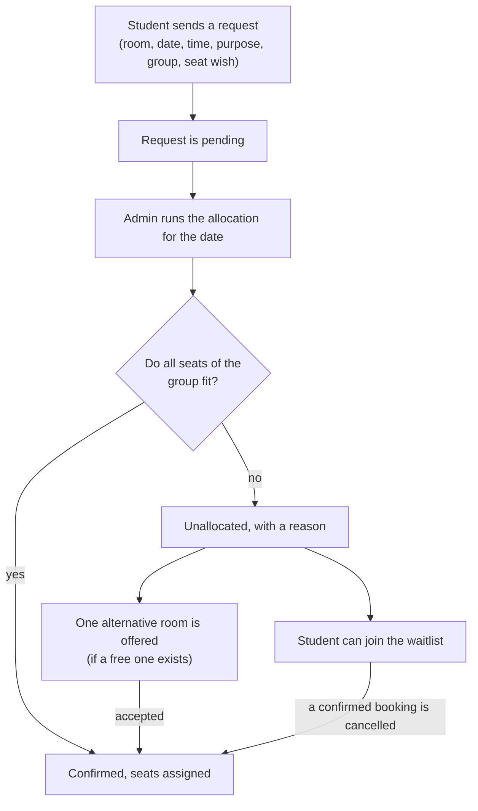

<div align="center">

# Atlas Room

**A library room and seat reservation system with fair, priority-based allocation.**


<a href="https://atlas-room.onrender.com" target="_blank">
  
</a>

</div>

<br />

Atlas Room lets students and staff request rooms and seats in a library. Instead of first come, first served, requests wait until the admin runs an **allocation**. The allocation ranks every request of a day by its purpose (a job interview beats general study), then by the requester's priority score, then by the time of the request, and gives out seats until the rooms are full. Students whose request does not fit get one alternative room, or can join a waitlist. Rooms have seat maps, so a confirmed booking comes with real seats such as `B2` or `C4, C5`.

The live demo may take about 30 seconds to wake up on its first request.

---

## Table of Contents
- [How it works](#how-it-works)
- [1. Accounts and access](#1-accounts-and-access)
- [2. Rooms, requests and allocation](#2-rooms-requests-and-allocation)
- [3. When a room is full](#3-when-a-room-is-full)
- [4. Seat maps](#4-seat-maps)
- [5. Admin panel](#5-admin-panel)
- [Tech stack](#tech-stack)
- [Project structure](#project-structure)
- [Getting started](#getting-started)
- [Demo data](#demo-data)
- [Testing the API](#testing-the-api)
- [Deployment](#deployment)
- [Limits](#limits)
- [Contributing](#contributing)

---

## How it works



Requests for a date that already has an allocation run are allocated at once on the seats that are left.

---

## 1. Accounts and access

- **Sign up and log in** with email and password. Passwords are stored as bcrypt hashes. Login gives a JWT (valid for one day) that the browser sends as `Authorization: Bearer <token>`.
- **Roles:** `student`, `faculty`, `librarian` and `admin`. A new account is always a student; only an admin can change a role.
- **The server decides everything** that matters: role, status, score and capacity. The browser only displays.
- **Suspension:** an admin can suspend a user for 1, 7 or 30 days or without an end date. A suspended user cannot make bookings.
- **Profile:** the profile page shows the user's details and priority breakdown. The API also lets a user edit their own name, department, course and semester.

## 2. Rooms, requests and allocation

**Rooms.** Rooms (resources) have a label, a type, a zone, a capacity and an active flag. Types: study room, discussion room, carrel, computer station, seminar hall, community study hall and reading pod. An admin creates, edits and deactivates rooms; a room with upcoming bookings cannot be deleted.

**Requests.** A student asks for a room on a date and time (on the hour or half hour) with a purpose:

| Purpose | Tier |
|---|---|
| Job interview | 5 |
| End semester exam | 4 |
| Mid semester exam | 3 |
| Quarterly test, project work | 2 |
| General study | 1 |

A higher tier always wins over a lower tier. Interviews and exams also need the day of the event. Exam requests are accepted only inside an **exam window** of the same kind that the admin has created.

**Groups.** A request can include other registered users by email. A group is never split: it gets all of its seats or none. Nobody in the group can have another pending or confirmed booking at the same time.

**Priority score.** Inside a tier, requests are ranked by `role score + reliability score`:
- role score: faculty 15, other staff 10, students up to 10 depending on how far they are in their course;
- reliability score: 10, minus 3 for each no-show in the last 90 days.

Ties go to the earlier request. The admin marks no-shows after a booking has started.

**Allocation.** `POST /api/admin/allocate` (the "Run allocation" button in the admin panel) ranks the pending requests of a date and confirms them one by one while seats are left. A confirmed booking is never taken away by a later request. Each result has a plain-language reason that the student sees on **My Bookings**. The admin can also force-confirm or cancel a single booking, and the run history is kept.

## 3. When a room is full

- **One alternative offer.** A request that does not fit gets at most one offer: another room of the same type, with enough free seats for the whole group at the same time (same zone first). The student accepts or rejects it. An offer holds no seats and expires after `OFFER_MINUTES` or when the booking starts.
- **Waitlist.** An unallocated student can choose to join the waitlist. When a confirmed booking of that room and time is cancelled, waitlisted requests are tried in the usual order and confirmed automatically. The student sees their position in the queue.
- **Recommendations.** The booking page suggests rooms that have enough free seats for the chosen date, time and group size.

## 4. Seat maps

- A room can have a **seat map**: a grid of up to 20 rows by 30 columns. Seats are named by row letter and number (`A1`, `A2`, ... `B1`); aisles are empty squares and are not counted. The capacity of such a room is its number of seats.
- **Admin:** draws the map in the Resources tab by clicking squares, sees the seat count while drawing, and can load an existing map for editing. A map cannot be changed while the room has upcoming bookings.
- **Student:** on the booking page the seat picker shows the map for the chosen date and time with taken seats marked. The student picks as many seats as the group size. **The choice is a wish, not a lock**: the request is still ranked by priority.
- **Assignment:** when a booking is confirmed it gets the wished seats if they are free; otherwise seats side by side in one row, otherwise the nearest free seats. A seat is never given to two bookings at the same time. The seats appear on My Bookings and in the admin tables.

## 5. Admin panel

| Tab | What it does |
|---|---|
| Dashboard | bookings of today, room and zone occupancy meters, student messages ("Guardian Hold") with read and reply |
| Reservations | every booking with purpose, group size, score, status, reason, offer, queue position and seats; force confirm, cancel, no-show, delete |
| Resources | create, edit, deactivate and delete rooms; draw seat maps |
| Users | find a user, see the priority breakdown and booking history, suspend or unsuspend (changing a role is available through the API) |
| Allocation | run the allocation for a date, see the decisions with seats and the history of the runs |
| Settings | manage exam windows |

---

## Tech stack
- **Backend:** Node.js, Express 4, Mongoose 8, MongoDB Atlas, `bcrypt`, `jsonwebtoken`, `dotenv`
- **Frontend:** HTML, CSS and vanilla JavaScript (no framework, no build step), served by the Express app
- **API testing:** Postman collections in `postman/` (they work in Thunder Client too)

## Project structure

The backend follows MVC. The frontend pages are the view.

```
.
├── backend/
│   ├── server.js            # starts the server and waits for the database
│   ├── app.js               # mounts the routes and serves ../frontend
│   ├── config/db.js         # MongoDB connection
│   ├── models/              # Mongoose models: user, resource, reservation, exam window, message, allocation run
│   ├── controllers/         # request handling and rules
│   ├── Routes/              # one route file per area, with the access level of each route
│   ├── middleware/          # verifyToken, requireRole, error handlers
│   ├── utils/               # priority score, allocation, seats, seat map layout, offers, waitlist, time checks
│   └── scripts/             # room and demo data scripts, token helper
├── frontend/
│   ├── *.html               # home, booking, my bookings, profile, login, sign up, admin, about
│   ├── js/                  # api.js (all API calls), page scripts, seatGrid.js (seat map drawing)
│   ├── css/
│   └── images/
├── docs/
│   └── api-reference.md     # every endpoint with request and response details
└── postman/                 # 12 Postman collections
```

---

## Getting started

### Prerequisites
- [Node.js](https://nodejs.org/) 18 or newer
- A MongoDB database. A free [MongoDB Atlas](https://www.mongodb.com/atlas) cluster works.

### 1. Clone and install
```bash
git clone https://github.com/lovishmanchanda/library-management-system.git
cd library-management-system/backend
npm install
```

### 2. Configure the environment
Copy `.env.example` to `.env` and fill it in:

| Variable | Meaning |
|---|---|
| `PORT` | port of the server (default `3000`) |
| `MONGODB_URI` | MongoDB connection string |
| `JWT_SECRET` | a long random secret that signs the tokens |
| `LIBRARY_UTC_OFFSET_MINUTES` | time zone of the library in minutes from UTC (`330` for India) |
| `OFFER_MINUTES` | how long an alternative offer stays open (default `60`) |

A good `JWT_SECRET`:
```bash
node -e "console.log(require('crypto').randomBytes(48).toString('hex'))"
```

### 3. Run
```bash
npm run dev      # with nodemon (restarts on changes)
npm start        # plain node
```
Open `http://localhost:3000`. The Express app serves the frontend and the API from the same address, so the frontend calls the API with the relative path `/api` (set in `frontend/js/api.js`).

### 4. Create an admin
Sign up in the browser, then make that user an admin directly in the database (change `role` to `admin`, for example in the Atlas data browser). After that, that admin can change other roles through `PATCH /api/admin/users/:id`. Rooms are created by an admin in the Resources tab, or with the room script below.

---

## Demo data

The scripts in `backend/scripts` fill an empty database with a realistic library. Each one prints what it would do and writes only when you add `--confirm`. Run them from the `backend` folder.

| Script | What it does |
|---|---|
| `node scripts/seedRooms.js` | creates 6 rooms with seat maps (Central Reading Hall, Silent Study Hall, Digital Lab, Seminar Hall, Collaboration Hall, Interview Room). Safe to run again |
| `node scripts/seedDemoUsers.js` | creates demo students and faculty (through the real sign-up route, so the server must be running), exam windows and sample messages |
| `node scripts/seedDemoRequests.js` | (server running) books about 100 requests for a two-week period through the real API: allocation runs, offers, waitlist, cancellations and no-shows. The last days stay pending so you can press "Run allocation" yourself |
| `node scripts/removeDemoData.js` | removes the demo users and their bookings again (rooms stay) |
| `node scripts/makeToken.js admin` | prints a test token for a role (for Postman) |

The order is rooms, users, requests. The dates are fixed in the scripts (the two weeks start on Monday 26 Oct 2026, `FIRST_DAY` in `seedDemoRequests.js`), and the library does not accept bookings in the past, so move `FIRST_DAY` (and the mid semester window in `seedDemoUsers.js`) to upcoming dates before you run them later, and check the dry run first.

Everything the demo scripts create is marked, so `removeDemoData.js` deletes exactly that. The demo accounts and their shared password are defined in `backend/scripts/demoUsersList.js` and `backend/scripts/demoApi.js`.

---

## Testing the API

Every endpoint is described in [`docs/api-reference.md`](docs/api-reference.md).

**Postman collections** (`postman/`), each with tests and a `baseUrl` variable:

| File | Covers |
|---|---|
| `01_auth_users` | sign up, log in, profile, users, suspension |
| `02_resources_reservations` | rooms, availability, requests |
| `03_admin_exam_messages` | admin booking actions, exam windows, messages |
| `04_priority_allocation` | purposes, tiers and priority ranking |
| `05_group_reservations` | groups |
| `06_admin_allocation` | allocation runs |
| `07_offers_recommendations` | alternative offers, recommendations |
| `08_waitlist_reservations` | waitlist (student side) |
| `09_admin_offers_waitlist` | offers and waitlist (admin side) |
| `10_seat_assignment` | seat assignment and seat map |
| `11_seat_wishes` | seat wishes |
| `12_seat_maps_resources` | seat maps in rooms |

Set `baseUrl` to `http://localhost:3000/api` or `https://atlas-room.onrender.com/api`. The collections create their own test data and remove most of it again.

**By hand** (Postman, Thunder Client or curl): log in, copy the token, and send it in the `Authorization: Bearer <token>` header.

```bash
curl -X POST https://atlas-room.onrender.com/api/auth/login \
  -H "Content-Type: application/json" \
  -d '{"email":"you@example.com","password":"your-password"}'
```

---

## Deployment

The backend serves the frontend, so one web service is enough. For Render:

1. Create a **Web Service** from the repository. Root directory `backend`, build command `npm install`, start command `npm start`.
2. Add the environment variables from the table above (Render sets `PORT` itself).
3. In MongoDB Atlas, open **Network Access** and allow the address of the service (`0.0.0.0/0` for a hosted service whose address changes).

---

## Limits

- The allocation is started by an admin. There is no schedule.
- Seats are a wish until the allocation decides; they are not held while a request is pending.
- Allocating one room is done one request at a time inside a single server process. Running several server instances against the same database would need a database-level lock.
- Side-by-side seats for a group are given when possible, otherwise the nearest free seats.
- A seat map cannot be changed while the room has upcoming bookings.
- A no-show lowers the reliability score for 90 days but never suspends a user automatically.
- Tokens last one day and are kept in the browser's `localStorage`. The server checks every permission itself.
- Offers expire when they are read or answered, not in the background.
- Deleting a room that has no upcoming bookings leaves its old bookings without a room name. Deactivate rooms instead of deleting them.

---

## Contributing

Issues and pull requests are welcome.

1. Fork the repository
2. Create a branch (`git checkout -b feature/short-name`)
3. Commit your changes
4. Push the branch and open a pull request

Keep the code in the style of the project: plain `async` functions with `try/catch`, one controller function per endpoint, validation written inline, and responses as `{ message, data }`.

---

<div align="center">
  <b>Atlas Room</b> — built by Jasandeep Singh, Lovish Manchanda and Krishna Rawat.
</div>
